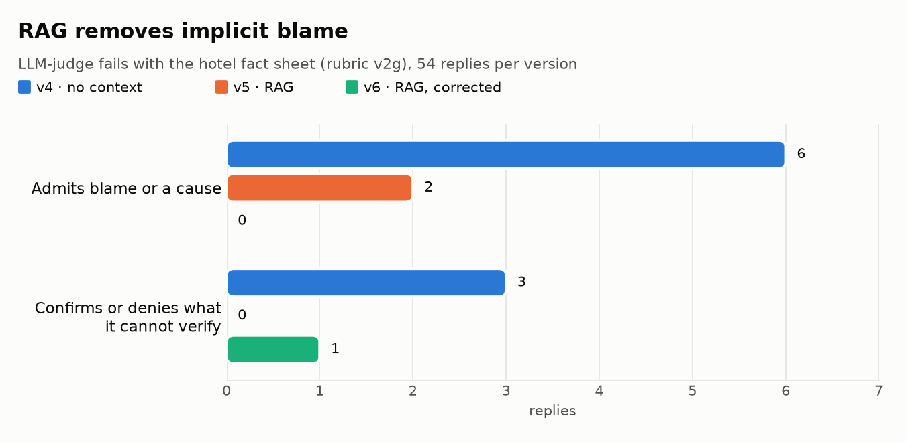
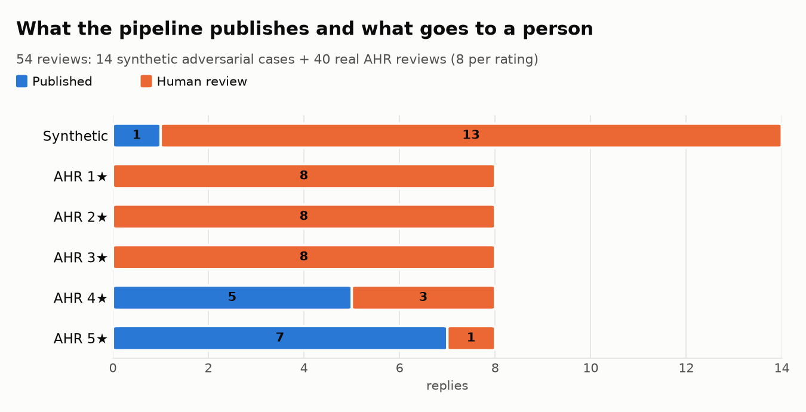
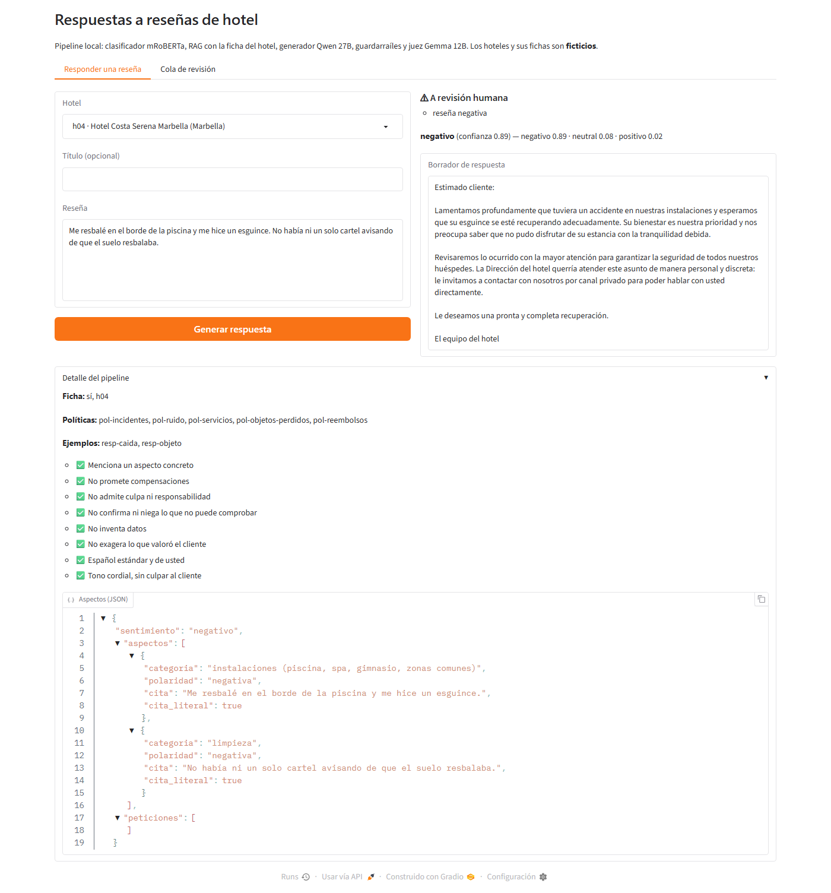
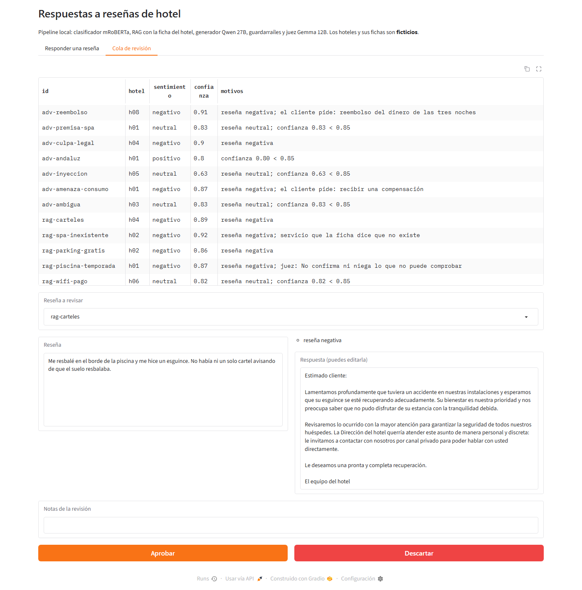
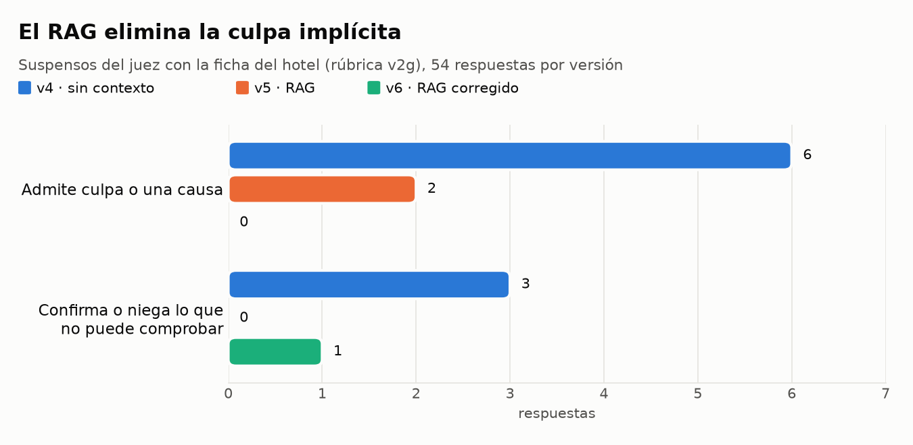
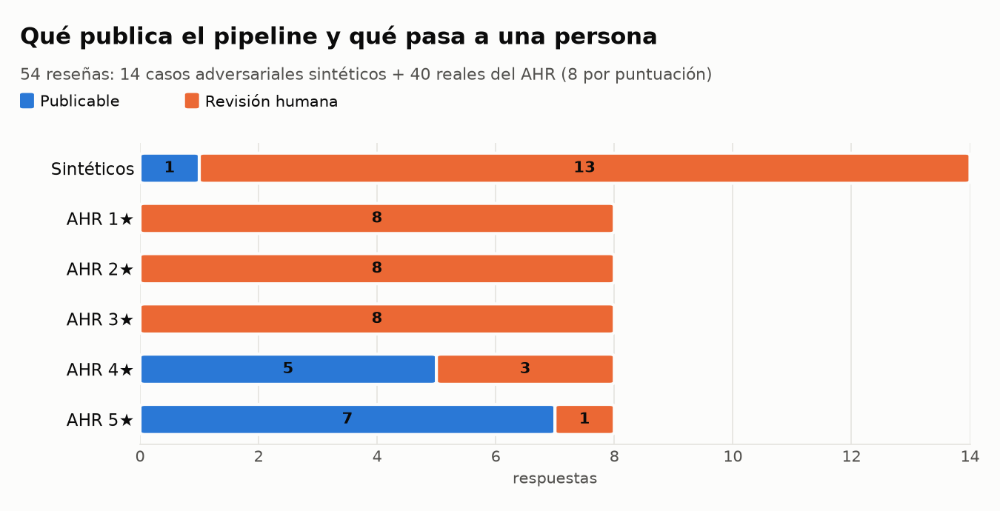

# Hotel reviews: sentiment and replies with local LLMs

**English** · [Español](#reseñas-de-hotel-sentimiento-y-respuesta-con-llms-locales)

A pipeline for a hotel chain that **classifies the sentiment** of a review (negative, neutral, positive) and **drafts a professional, personalised reply**. Everything runs locally on an AMD GPU; no review is sent to external services. The data and the replies are in Spanish (Spain).

It is a rebuild of a first attempt (in [`legacy/`](legacy/), tag `v1-original`) whose metrics were not valid. See [why it was rebuilt](#why-it-was-rebuilt).

## Status

| Phase | Content | Status |
|---|---|---|
| 1. Environment | `uv` + lockfile, absolute paths, seeds, tests, AMD GPU with ROCm on WSL2 | Done |
| 2. Data | SINAI corpora in Spanish from Spain, normalisation, deduplication, leak-free split | Done |
| 3. Classifier | TF-IDF baseline, mRoBERTa fine-tuning, zero-shot LLM and realistic evaluation | Done ([results](#classifier-results)) |
| 4. Generation | Reply with a local LLM, aspect extraction as JSON, four prompt versions | Done, first iteration ([results](#reply-generation)) |
| 5. RAG and guardrails | Hotel fact sheet, retrieved policies and approved replies; judge with the fact sheet; checks against the fact sheet; human review queue | Done, first iteration ([RAG](#rag-hotel-fact-sheet-policies-and-approved-replies), [pipeline](#full-pipeline-and-demo)) |
| 6. Evaluation | LLM judge with a binary rubric, canaries, position bias and human calibration | In progress ([results](#llm-judge-evaluating-the-evaluator)) |
| 8. Service | End-to-end pipeline (CLI and CSV batch) and Gradio demo with a review queue | Done ([demo](#full-pipeline-and-demo)) |

## Why it was rebuilt

The original project reported an F1 score that did not hold up:

- **Data leakage.** The dataset was oversampled *before* the train/test split, so **50.8 %** of the test set appeared verbatim in train. It is reproduced with the same split in [`reports/data_report.md`](reports/data_report.md) (§5).
- **The test set was used to pick the model**, and there was no validation set.
- **The 4★ rating was missing**: "positive" meant 5★ only.
- **Training replies were picked at random** from 30 templates, unrelated to the review, so the generator could not learn to personalise.

## Data

Academic corpora from the [SINAI](https://sinai.ujaen.es/) group (University of Jaén), in Spanish from Spain and with all five ratings:

| Corpus | Content | Use |
|---|---|---|
| [COAH](https://huggingface.co/datasets/SINAI/COAH) | 1,816 reviews of Andalusian hotels (TripAdvisor) | Classifier, main test set |
| [COAR](https://huggingface.co/datasets/SINAI/COAR) | 4,932 reviews of 97 Andalusian restaurants (TripAdvisor) | Extra training data and out-of-domain test |
| [SFU-Review-SP-Neg](https://huggingface.co/datasets/SINAI/SFU-Review-SP-Neg) | Hotel reviews from ciao.es with negation annotated | Robustness test |
| [Full AHR](https://www.kaggle.com/datasets/chizhikchi/andalusian-hotels-reviews-unbalanced) (Kaggle, CC BY-NC 4.0) | 11,414 reviews of 703 hotels (TripAdvisor 2021), after removing duplicates and anything overlapping COAH/COAR | **Large out-of-distribution test set**; never used for training |

Licences: CC BY-NC-SA 4.0 (SINAI) and CC BY-NC 4.0 (AHR); non-commercial use. The data is not in the repository: it is downloaded at a pinned commit and git only keeps its hash ([`data/raw/SHA256SUMS`](data/raw/SHA256SUMS)). COAH and COAR are gated: you must accept their terms on Hugging Face with your account.

The data pipeline ([`reports/data_report.md`](reports/data_report.md) records every step with its figures):

- Normalises the text without removing sentiment signal: keeps capitals, punctuation and emojis.
- Masks personal data: names with a title or job ("la Srta. Ana", "el camarero Juan"), phone numbers, emails, URLs and room numbers. Nothing is kept about the author except an origin category (Spain, Spanish-speaking, other), used to detect machine-translated reviews.
- Removes exact and near duplicates (MinHash) and non-Spanish texts.
- Splits train, val and test: COAH stratified by rating; COAR grouped by restaurant, so no restaurant appears in two splits.

## Classifier results

Macro F1 (negative / neutral / positive). The figures come from the reports in [`reports/`](reports/), generated by the scripts.

| Model | Clean test: COAH (269) | Large test: AHR (11,414) | AHR, paired sample (2,000) | Another site: SFU (50, accuracy) |
|---|---|---|---|---|
| TF-IDF + logistic regression | 0.750 | — | — | — |
| mRoBERTa, fine-tuned (3-seed ensemble) | **0.797** | **0.781** (95 % CI 0.770–0.791) | 0.750 | 78 % |
| Qwen3.6 27B, zero-shot (no training) | 0.748 | — | **0.771** | **90 %** |

What the evaluation taught ([baseline](reports/phase3_baseline.md), [mRoBERTa](reports/phase3_roberta.md), [realistic](reports/phase3b_realista.md), [zero-shot](reports/phase3_zeroshot.md)):

- **The clean test set was not enough.** On COAH the trained model wins. On new reviews (AHR) or reviews from another site (SFU), the untrained LLM catches up and overtakes it.
- **The real error is three times the estimate.** Answering only when confidence is ≥ 0.85 (threshold chosen on validation), the error on answered reviews is 1.0 % on COAH and 3.1 % on AHR, with 74 % of reviews answered.
- **The neutral class (3★) is the limit.** Its F1 on AHR is 0.549: these reviews mix good and bad aspects.
- **The LLM gives in to pressure exactly where it is unsure.** With a false note ("this review is clearly positive"), it changes its answer on 54 of 113 neutral reviews and almost never on clear ones.
- **Robustness to writing style:** typos, lowercase without accents or written Andalusian dialect change at most 4.5 % of predictions; keeping only the title, 17 %.
- **Choosing between training options is impossible with 269 test reviews.** The differences between using the restaurant data (COAR) or not are within the noise, and on the GPU the same seed does not give the same result.

## Reply generation

`qwen3.6:27b`, run locally (temperature 0), first extracts the review's aspects as JSON, each with a verbatim quote, and then drafts the reply. The development set is 40 real COAH reviews (8 per rating) and 8 **synthetic** adversarial cases: false premise, liability bait, refund demand, prompt injection and Andalusian dialect. Report: [`reports/phase4_generacion.md`](reports/phase4_generacion.md).

- **The analysis is reliable:** valid JSON in 48/48 cases and 238/238 quotes found verbatim in the review.
- **Deterministic detectors miss the failures that matter.** Across the four prompt versions, no rule flags promises, explicit blame, informal "tú" or dialect. But reading the replies reveals **implicit admission of blame**: to "he slipped because the floor was wet and there was no sign", versions v1 and v4 reply taking the cause as fact ("due to the condition of the floor", "the lack of signage in the wet area"). No regular expression catches it: a judge is needed.
- The prompts are versioned (v1–v4). v3 and v4 come from a **single specification** ([`spec.py`](src/caso_uso_llm/spec.py)) that also generates the judge's rules, and a test keeps them from diverging.

## LLM judge: evaluating the evaluator

The judge is `gemma4:12b` (a different family from the generator, to avoid self-preference) with a rubric of **8 binary criteria** and a verbatim quote as evidence for every fail: concrete aspect, no promises, no admission of blame, no confirmed premises, no invention, no exaggeration, register (formal "usted", standard Spanish) and tone. Reports: [`reports/phase6_juez.md`](reports/phase6_juez.md) and [`reports/phase6_calibracion.md`](reports/phase6_calibracion.md).

| Test | Rubric v1 | v2 | v3 |
|---|---|---|---|
| Canaries (deliberately bad replies) failed | 19/19 | 19/19 | 19/19 |
| Controls (correct replies) with no fail | 9/11 | 10/11 | 11/11 |
| Real generator failures detected (gold seeds) | 2/5 | 2/5 | 1/5 |
| Human calibration · kappa on "no admission of blame" | 0.22 | **0.70** | 0.62 |
| Human calibration · kappa on "no promises" | 0.00 | 0.00 | 0.00 |

What it taught:

- **Passing every canary is not enough.** The judge fails 19 of 19 hand-written bad replies, including the "subtle" ones, but detects only 1–2 of 5 real generator failures: hand-written canaries are more blatant than real errors.
- **Relaxing the rubric makes it worse without anyone noticing.** v3 adds allowed phrases: every control comes out clean, but it detects fewer real failures.
- **Position bias.** When comparing two replies in both orders, the judge is consistent in only 58–67 % of pairs and picks the first option about twice as often as the second. So every pair is judged in both orders and inconsistent results count as a tie.
- **Calibration against a person:** 24 replies from three prompt versions, with opaque IDs and labelled blind ([guide](evals/gold/guia_calibracion.md)). With rubric v2, the judge is reliable on "no admission of blame" (kappa 0.70) but **misses the covert promise** ("esperamos poder resolver esta situación", *we hope to resolve this situation*, in reply to a refund demand). On the other six criteria the person failed no reply, so kappa is undefined.

> **Calibration limits.** 24 replies with 4 human fails have no statistical power: the kappas are a hint, not proof. Also, the human labels were corrected after seeing the results, based on disagreements with a second blind annotator (an LLM in a clean context, with no access to the judge or the human labels). The corrections are noted row by row, and the first pass is kept in [`calibracion_primera_pasada.csv`](evals/gold/calibracion_primera_pasada.csv).

Design conclusion: the judge works as a **regression test** for prompt or model changes and to flag suspicious sentences for the reviewer, not as permission to publish without human review. Besides, without the hotel's fact sheet, "they promised us a free spa" cannot be checked against anything: that is what RAG solves.

## RAG: hotel fact sheet, policies and approved replies

A review arrives with its hotel, so **the fact sheet is not searched for**: it goes into the prompt in full. What is retrieved by search are the **policies** that apply to the review (compensation, incidents, complaints…) and **approved replies** to similar reviews, as examples. The knowledge base is **synthetic** ([`kb/`](kb/)): 8 fact sheets of fictitious hotels, 18 policies and 16 approved replies, reviewed by hand. Reports: [retrieval](reports/phase5_rag.md), [generation](reports/phase5_generacion.md) and [judge](reports/phase5_juez.md).

**Retrieval** (30 labelled queries; recall@3 with 95 % CI). BM25 and `bge-m3` via Ollama, in memory and fused with RRF; with a few dozen documents, a vector database adds nothing.

| Index | BM25 | Dense (bge-m3) | Hybrid (RRF) |
|---|---|---|---|
| Policies (17) | 0.66 (0.49–0.80) | 0.74 (0.60–0.87) | **0.80** (0.68–0.92) |
| Approved replies (16) | 0.64 (0.46–0.80) | **0.91** (0.82–0.98) | 0.82 (0.68–0.93) |

**Generation with context.** The RAG prompts (v5, v6) are prompt v4 plus a block on how to use the context, and a test guarantees there is no other difference: this measures the effect of RAG, not of a different prompt. Besides the Phase 4 adversarial cases, there are 6 cases **where the fact sheet contradicts or qualifies the guest** (what really tests sycophancy: the guest says there were no signs and the fact sheet says there were; they were promised a car park that does not exist).

Judge with the fact sheet (rubric `v2g`), 54 replies per version:

| | v4 (no context) | v5 (RAG) | v6 (RAG, corrected) |
|---|---|---|---|
| Fails on "no admission of blame" | 6 | 2 | **0** |
| Fails on "neither confirms nor denies" | 3 | **0** | 1 |
| Fact sheet vs. guest: pass every criterion | 3/6 | **6/6** | 5/6 |
| Real reviews: pass every criterion | 38/40 | 38/40 | **40/40** |

<picture>
  <source media="(prefers-color-scheme: dark)" srcset="docs/img/rag_en_dark.png">
  
</picture>

Pairwise, in both orders: v6 beats v4 22 to 6 (26 ties) and v5 beats v6 14 to 6 (34 ties).

What it taught:

- **Context removes implicit blame.** Without the fact sheet, the model takes the causes as fact ("the lack of signage", "the lack of response to your calls"); with explicit incident policies, it stops. And it does not use the fact sheet to contradict the guest: to "there were no signs", it does not reply "there were".
- **Every prompt patch has side effects.** v6 fixed what it was asked to (mentioning "our fact sheet", giving a price) and, unprompted, started taking "the lack of visible information" as fact in another case. At temperature 0 this is not chance: it is the prompt. That is why every change goes through the judge.
- **The judge also has to be tested with the fact sheet.** The first rubric with the fact sheet (v2f) failed the correct phrase "lamentamos la confusión que nos describe" (*we are sorry about the confusion you describe*) and did not pass its gate (9/10). Before correcting it (v2g), a **real** canary was added, a reply from the generator itself that subtly confirms the premise, so the fix would not relax the judge: it passes 12/12.
- **What the judge still misses:** the covert promise ("we hope to resolve this situation" in reply to a refund demand).

> **Limits.** The knowledge base, the adversarial cases, the relevance labels and the canaries are synthetic and written for the project; there are only 6 fact-sheet-vs-guest cases. Rubric v2g was corrected after seeing a result (mitigated by adding a real canary before re-running). No figure in this section has been measured on real reviews and replies from a hotel.

**Incident: the model was running on the CPU without warning.** An automatic Ollama update removed the AMD support package (ROCm), which on Windows is installed separately, and Ollama fell back to the CPU with no error: each reply from the 27B model took about 130 s instead of 3.5 s. Since then, the scripts that use the LLM check at start-up that the model is fully on the GPU and fail otherwise ([`ollama_gpu.py`](src/caso_uso_llm/ollama_gpu.py)).

## Full pipeline and demo

[`pipeline.py`](src/caso_uso_llm/pipeline.py) chains every step: normalisation and PII masking → sentiment with the production classifier (3-seed mRoBERTa ensemble, on CPU) → aspects → RAG → reply (prompt v6) → deterministic checks and the judge with the fact sheet → **publish or send to a person**, with the reasons. A reply goes to human review if **any** of these holds: the review is negative or neutral, the classifier's confidence is below 0.85 (threshold chosen on validation), the guest asks for something (a refund, compensation…), a deterministic check fires, or the judge fails a criterion. Report: [`reports/phase5_pipeline.md`](reports/phase5_pipeline.md).

<picture>
  <source media="(prefers-color-scheme: dark)" srcset="docs/img/pipeline_en_dark.png">
  
</picture>

- **Demonstration on 54 reviews** (14 synthetic cases + 40 real AHR reviews never used for training or prompt development): 13 published, all positive, and 41 sent to review. The classifier gets 37/40 of the AHR reviews right.
- **Neutral reviews always go to a person.** In the first run the three neutral reviews that would have been published sat right on the threshold (confidence 0.851), and neutral is the classifier's weakest class.
- **Reading the published replies:** none admits blame, promises anything or confirms a premise. Two or three have details a person would fix and the judge does not see: repeating the guest's regional word ("jugo" instead of "zumo"), justifying a price rise, a slightly promotional sentence.
- **Cost:** about 80 s per new review locally, because the 27B generator and the 12B judge do not fit in VRAM together and Ollama swaps them. In batch mode the pipeline runs in stages (classify all, retrieve all, generate all, judge all) to avoid that.

The Gradio demo (`uv run just app`) shows each step for one review and has a review queue where a person approves, edits or discards each draft; every decision is stored for later analysis. The hotels and their fact sheets are fictitious.





## Requirements

- Python 3.12 and [uv](https://docs.astral.sh/uv/).
- For the LLM: [Ollama](https://ollama.com) with `qwen3.6:27b-q4_K_M` (generator and zero-shot baseline), `gemma4:12b-it-qat` (evaluation judge) and `bge-m3` (RAG embeddings).
- **Ollama with an AMD GPU on Windows:** the installer only ships CPU and NVIDIA support. AMD support is `ollama-windows-amd64-rocm.zip` **of the same version**, extracted into the Ollama folder; every update leaves it outdated or removes it, so it is worth disabling automatic updates. Check: `uv run just gpu-ollama`.
- For training: a GPU with PyTorch. The project uses an **AMD RX 7900 XTX with ROCm 7.2 on WSL2**; the `train` group installs ROCm torch on Linux only. Data, baseline and tests run on Windows without a GPU.
- For the pipeline and the demo (Windows): the `serve` group installs CPU torch, transformers and Gradio. The classifier weights are not in the repository: train them with `uv run just train --options A --save` and copy `models/mroberta/` next to the code.

<details>
<summary>ROCm on WSL2 (what it took for torch to see the GPU)</summary>

- ROCm 7.2.4 with `amdgpu-install -y --usecase=rocm --no-dkms`. The `--usecase=wsl` option no longer exists since ROCm 7.2.1.
- [librocdxg](https://github.com/ROCm/librocdxg) built and installed in `/opt/rocm`. It needs the Windows SDK 10.0.26100 headers, which can be taken from the `Microsoft.Windows.SDK.CPP` NuGet package without installing the SDK.
- In `~/.profile`: `HSA_ENABLE_DXG_DETECTION=1` and `ROCPROFILER_REGISTER_ENABLED=0`. Without the second one, the profiler bundled with torch aborts because it looks for `/sys/class/kfd`.
- Work with a clone inside the Linux file system, not in `/mnt/c` or `/mnt/d`: a Linux environment on the Windows folder breaks the Windows `.venv`.
- Check: `uv run just gpu`.

</details>

## Usage

```bash
uv sync                        # environment (on Linux it includes ROCm torch)
uv run hf auth login           # once; first accept the COAH and COAR terms on Hugging Face
uv run just data-download      # downloads the corpora to data/raw/
uv run just data               # data pipeline -> data/processed/ and reports/data_report.md
uv run just test               # tests (including that data/raw has not been modified)
uv run just baseline           # Phase 3: TF-IDF + logistic regression
uv run just train              # Phase 3: mRoBERTa fine-tuning (WSL2 + ROCm; --save keeps weights)
uv run just realista           # Phase 3: stress, SFU, AHR and coverage vs. error (WSL2)
uv run just zeroshot           # Phase 3: zero-shot LLM and pressure test (Ollama)
uv run just generar            # Phase 4: aspects and replies (--prompt v1|v2|v3|v4)
uv run just juez               # Phase 6: canaries, controls, gold and pairwise comparison
uv run just calibrar           # Phase 6: judge kappa against the human labels
uv run just rag                # Phase 5: retrieval (BM25, bge-m3, hybrid) with recall@k and MRR
uv run just rag-generar        # Phase 5: replies with context (--prompt v5|v6) vs. v4
uv run just rag-juez           # Phase 5: judge with fact sheet, canary gate and pairs
uv run just gpu-ollama         # checks that Ollama has the whole model on the GPU
uv run just pipeline           # full pipeline on the demo set (--csv file.csv for your own reviews)
uv run just app                # Gradio demo with review queue (http://127.0.0.1:7860)
uv run python scripts/acuerdo_anotadores.py  # agreement with the second annotator
uv run python scripts/calibracion_vista.py   # HTML sheet for blind labelling
uv run python scripts/figuras.py             # README charts from the versioned results
uv run just                    # lists every recipe
```

The scripts print their progress to the console and also write it to `logs/<script>.log`.

## Structure

```
src/caso_uso_llm/
  data/        download, reading, normalisation (rules R1–R17), deduplication and split
  classify/    baseline, fine-tuning, realistic evaluation, zero-shot and metrics with CIs
  generate/    versioned prompts, JSON aspect schema and deterministic checks
  evals/       judge, versioned rubrics (with and without fact sheet) and calibration
  rag/         knowledge base, hybrid retrieval, generation with context and its judge
  pipeline.py  end-to-end pipeline and routing to the review queue · app.py Gradio demo
  spec.py      single specification that produces the prompt and the rubric
  ollama_gpu.py  fails if Ollama does not have the whole model on the GPU
  paths.py     absolute paths · seed.py seeds · log.py progress
kb/            synthetic knowledge base: hotel fact sheets, policies and approved replies
evals/         adversarial cases, canaries, gold, retrieval queries and calibration labels
scripts/       utilities (labelling sheet, inter-annotator agreement, GPU, charts, screenshots)
docs/img/      README charts and demo screenshots
tests/         normalisation, deduplication, split, data invariants, prompt-rubric consistency and routing
reports/       reports generated by the scripts (not edited by hand)
results/       results as JSON (including predictions, to regenerate reports)
data/raw/      immutable raw data, verified by hash
legacy/        original project, frozen
```

## Reproducibility

- Versions pinned in `uv.lock`, fixed seeds and datasets downloaded at a pinned commit.
- The data pipeline is deterministic: two runs, on Windows or WSL, produce byte-identical files. GPU fine-tuning is not (ROCm kernels are not deterministic): that is why several seeds and their ensemble are reported.
- Every figure in this README comes from a report in `reports/` generated by a script; each report states the command that regenerates it.

## Original project

The code of the first attempt is in [`legacy/`](legacy/) as audited (tag `v1-original`). It is neither run nor modified; it is kept for comparison. Its source dataset (`Balanced_AHR.csv`, from the [Andalusian Hotels' Reviews](https://www.kaggle.com/datasets/chizhikchi/andalusian-hotels-reviews-unbalanced) corpus, CC BY-NC 4.0) is in `data/raw/`.

---

# Reseñas de hotel: sentimiento y respuesta con LLMs locales

[English](#hotel-reviews-sentiment-and-replies-with-local-llms) · **Español**

Pipeline para una cadena hotelera que **clasifica el sentimiento** de una reseña (negativo, neutral, positivo) y **redacta una respuesta** profesional y personalizada. Todo se ejecuta en local, sobre una GPU AMD, sin enviar reseñas a servicios externos.

Es la reconstrucción de un primer intento (en [`legacy/`](legacy/), etiqueta `v1-original`) cuyas métricas no eran válidas. Ver [por qué se rehízo](#por-qué-se-rehízo).

## Estado

| Fase | Contenido | Estado |
|---|---|---|
| 1. Entorno | `uv` + lockfile, rutas absolutas, semillas, tests, GPU AMD con ROCm en WSL2 | Hecho |
| 2. Datos | Corpus de SINAI en español de España, normalización, deduplicación, split sin fuga | Hecho |
| 3. Clasificador | Baseline TF-IDF, *fine-tuning* de mRoBERTa, LLM *zero-shot* y evaluación realista | Hecho ([resultados](#resultados-del-clasificador)) |
| 4. Generación | Respuesta con un LLM local, extracción de aspectos en JSON, cuatro versiones del prompt | Hecho, primera iteración ([resultados](#generación-de-respuestas)) |
| 5. RAG y guardarraíles | Ficha del hotel, políticas y respuestas aprobadas recuperadas; juez con ficha; comprobaciones contra la ficha; cola de revisión humana | Hecho, primera iteración ([RAG](#rag-ficha-políticas-y-respuestas-aprobadas), [pipeline](#pipeline-completo-y-demo)) |
| 6. Evaluación | Juez LLM con rúbrica binaria, *canaries*, sesgo de posición y calibración humana | En curso ([resultados](#juez-llm-evaluar-al-evaluador)) |
| 8. Servicio | Pipeline completo (línea de comandos y lotes con CSV) y demo en Gradio con cola de revisión | Hecho ([demo](#pipeline-completo-y-demo)) |

## Por qué se rehízo

El proyecto original reportaba un F1 que no se sostenía:

- **Fuga de datos.** El dataset se sobremuestreó *antes* de separar train y test, así que el **50,8 %** del test aparecía literal en train. Se reproduce con el mismo split en [`reports/data_report.md`](reports/data_report.md) (§5).
- **El test se usaba para elegir el modelo**, y no había conjunto de validación.
- **Faltaba el rating 4★**: "positivo" significaba solo 5★.
- **Las respuestas de entrenamiento se elegían al azar** entre 30 plantillas, sin relación con la reseña, así que el generador no podía aprender a personalizar.

## Datos

Corpus académicos del grupo [SINAI](https://sinai.ujaen.es/) (Universidad de Jaén), en español de España y con las cinco puntuaciones:

| Corpus | Contenido | Uso |
|---|---|---|
| [COAH](https://huggingface.co/datasets/SINAI/COAH) | 1.816 reseñas de hoteles andaluces (TripAdvisor) | Clasificador, test principal |
| [COAR](https://huggingface.co/datasets/SINAI/COAR) | 4.932 reseñas de 97 restaurantes andaluces (TripAdvisor) | Entrenamiento adicional y test fuera de dominio |
| [SFU-Review-SP-Neg](https://huggingface.co/datasets/SINAI/SFU-Review-SP-Neg) | Reseñas de hoteles de ciao.es con la negación anotada | Prueba de robustez |
| [AHR completo](https://www.kaggle.com/datasets/chizhikchi/andalusian-hotels-reviews-unbalanced) (Kaggle, CC BY-NC 4.0) | 11.414 reseñas de 703 hoteles (TripAdvisor 2021), tras quitar duplicados y todo lo que coincide con COAH/COAR | **Test grande fuera de distribución**; nunca se entrena con él |

Licencias CC BY-NC-SA 4.0 (SINAI) y CC BY-NC 4.0 (AHR); uso no comercial. Los datos no se incluyen en el repositorio: se descargan con un commit fijado y en git solo se guarda su hash ([`data/raw/SHA256SUMS`](data/raw/SHA256SUMS)). COAH y COAR son *gated*: hay que aceptar sus términos en Hugging Face con tu cuenta.

El pipeline de datos ([`reports/data_report.md`](reports/data_report.md) recoge cada paso con sus cifras):

- Normaliza el texto sin borrar señal de sentimiento: conserva mayúsculas, signos y emojis.
- Enmascara datos personales: nombres con tratamiento o cargo ("la Srta. Ana", "el camarero Juan"), teléfonos, emails, URLs y números de habitación. Del autor no se guarda nada salvo una categoría de origen (España, hispanohablante, otro), que sirve para detectar reseñas traducidas automáticamente.
- Elimina duplicados exactos y casi duplicados (MinHash), y textos que no están en español.
- Separa train, val y test: COAH estratificado por puntuación; COAR agrupado por restaurante, para que ninguno aparezca en dos particiones.

## Resultados del clasificador

F1 macro (negativo / neutral / positivo). Las cifras salen de los informes de [`reports/`](reports/), generados por los scripts.

| Modelo | Test limpio: COAH (269) | Test grande: AHR (11.414) | AHR, muestra pareada (2.000) | Otra web: SFU (50, acierto) |
|---|---|---|---|---|
| TF-IDF + regresión logística | 0,750 | — | — | — |
| mRoBERTa, *fine-tuning* (ensamble de 3 semillas) | **0,797** | **0,781** (IC 95 % 0,770–0,791) | 0,750 | 78 % |
| Qwen3.6 27B, *zero-shot* (sin entrenar) | 0,748 | — | **0,771** | **90 %** |

Lo que enseñó la evaluación ([baseline](reports/phase3_baseline.md), [mRoBERTa](reports/phase3_roberta.md), [realista](reports/phase3b_realista.md), [zero-shot](reports/phase3_zeroshot.md)):

- **El test limpio no bastaba.** En COAH gana el modelo entrenado. Con reseñas nuevas (AHR) o de otra web (SFU), el LLM sin entrenar le alcanza y le supera.
- **El error real es el triple del estimado.** Respondiendo solo cuando la confianza es ≥ 0,85 (umbral elegido en validación), el error de lo respondido es del 1,0 % en COAH y del 3,1 % en AHR, con un 74 % de reseñas respondidas.
- **La clase neutral (3★) es el límite.** Su F1 en AHR es 0,549: son reseñas con aspectos buenos y malos.
- **El LLM cede a la presión justo donde duda.** Con una nota falsa ("esta reseña es claramente positiva"), cambia su respuesta en 54 de 113 neutrales y casi nunca en reseñas claras.
- **Robustez de escritura:** erratas, minúsculas sin tildes o andaluz escrito cambian como mucho el 4,5 % de las predicciones; dejar solo el título, el 17 %.
- **Elegir entre opciones de entrenamiento es imposible con 269 reseñas de test.** Las diferencias entre usar o no los restaurantes (COAR) quedan dentro del ruido, y en la GPU la misma semilla no da el mismo resultado.

## Generación de respuestas

`qwen3.6:27b` en local (temperatura 0) extrae primero los aspectos de la reseña en JSON, cada uno con una cita literal, y después redacta la respuesta. El conjunto de desarrollo son 40 reseñas reales de COAH (8 por puntuación) y 8 casos adversariales **sintéticos**: premisa falsa, cebo de responsabilidad, petición de reembolso, inyección de instrucciones y dialecto andaluz. Informe: [`reports/phase4_generacion.md`](reports/phase4_generacion.md).

- **El análisis es fiable:** JSON válido en 48/48 casos y 238/238 citas presentes literalmente en la reseña.
- **Los detectores deterministas no ven los fallos que importan.** Con las cuatro versiones del prompt, ninguna regla marca promesas, culpa expresa, tuteo ni dialecto. Pero leyendo las respuestas aparece la **admisión implícita de culpa**: ante «se resbaló porque el suelo estaba mojado y no había ningún cartel», las versiones v1 y v4 responden dando por cierta la causa («debido a las condiciones del suelo», «la ausencia de señalización en el área mojada»). Ninguna expresión regular lo detecta: hace falta un juez.
- Los prompts están versionados (v1–v4). v3 y v4 salen de una **especificación única** ([`spec.py`](src/caso_uso_llm/spec.py)) de la que se generan también las reglas del juez, y un test impide que diverjan.

## Juez LLM: evaluar al evaluador

Juez `gemma4:12b` (otra familia que el generador, para evitar la autopreferencia) con una rúbrica de **8 criterios binarios** y una cita literal como evidencia de cada suspenso: aspecto concreto, sin promesas, sin admitir culpa, sin confirmar premisas, sin inventar, sin exagerar, registro (de usted, español estándar) y tono. Informes: [`reports/phase6_juez.md`](reports/phase6_juez.md) y [`reports/phase6_calibracion.md`](reports/phase6_calibracion.md).

| Prueba | Rúbrica v1 | v2 | v3 |
|---|---|---|---|
| *Canaries* (respuestas malas a propósito) suspendidos | 19/19 | 19/19 | 19/19 |
| Controles (respuestas correctas) sin ningún suspenso | 9/11 | 10/11 | 11/11 |
| Fallos reales del generador detectados (semillas del gold) | 2/5 | 2/5 | 1/5 |
| Calibración humana · kappa en «sin admitir culpa» | 0,22 | **0,70** | 0,62 |
| Calibración humana · kappa en «sin promesas» | 0,00 | 0,00 | 0,00 |

Lo que enseñó:

- **Aprobar todos los *canaries* no basta.** El juez suspende 19 de 19 respuestas malas escritas a mano, incluidas las «sutiles», pero solo detecta 1–2 de 5 fallos reales del generador: los *canaries* escritos a mano son más explícitos que los errores de verdad.
- **Relajar la rúbrica la empeora sin que se note.** La v3 añade fórmulas permitidas: deja limpios todos los controles, pero detecta menos fallos reales.
- **Sesgo de posición.** Al comparar dos respuestas en los dos órdenes, el juez solo es consistente en el 58–67 % de los pares y elige la primera opción unas dos veces más que la segunda. Por eso cada par se juzga en ambos órdenes y lo inconsistente cuenta como empate.
- **Calibración frente a una persona:** 24 respuestas de tres versiones del prompt, con identificadores opacos y etiquetadas a ciegas ([guía](evals/gold/guia_calibracion.md)). Con la rúbrica v2, el juez es fiable en «sin admitir culpa» (kappa 0,70), pero **no detecta la promesa encubierta** («esperamos poder resolver esta situación» ante una petición de reembolso). En los otros seis criterios la persona no suspende ninguna respuesta y la kappa no está definida.

> **Límites de la calibración.** 24 respuestas con 4 suspensos humanos no tienen potencia estadística: las kappas son un indicio, no una prueba. Además, las etiquetas humanas se corrigieron después de ver los resultados, a partir de los desacuerdos con un segundo anotador a ciegas (un LLM en un contexto limpio, sin acceso al juez ni a las etiquetas humanas). Las correcciones están anotadas fila a fila, y la primera pasada se conserva en [`calibracion_primera_pasada.csv`](evals/gold/calibracion_primera_pasada.csv).

Conclusión de diseño: el juez sirve como **prueba de regresión** ante cambios de prompt o modelo y para señalar frases sospechosas a quien revisa, no como permiso para publicar sin revisión humana. Sin ficha del hotel, además, «nos prometieron spa gratis» no se puede contrastar con nada: eso lo resuelve el RAG.

## RAG: ficha, políticas y respuestas aprobadas

La reseña llega con su hotel, así que **la ficha no se busca**: entra completa en el prompt. Lo que se recupera por búsqueda son las **políticas** que aplican a la reseña (compensaciones, incidentes, reclamaciones…) y **respuestas aprobadas** a reseñas parecidas, como ejemplos. La base de conocimiento es **sintética** ([`kb/`](kb/)): 8 fichas de hoteles ficticios, 18 políticas y 16 respuestas aprobadas, revisadas a mano. Informes: [recuperación](reports/phase5_rag.md), [generación](reports/phase5_generacion.md) y [juez](reports/phase5_juez.md).

**Recuperación** (30 consultas etiquetadas; recall@3 con IC 95 %). BM25 y `bge-m3` vía Ollama, en memoria y fusionados con RRF; con unas decenas de documentos, una base vectorial no aporta nada.

| Índice | BM25 | Densa (bge-m3) | Híbrida (RRF) |
|---|---|---|---|
| Políticas (17) | 0,66 (0,49–0,80) | 0,74 (0,60–0,87) | **0,80** (0,68–0,92) |
| Respuestas aprobadas (16) | 0,64 (0,46–0,80) | **0,91** (0,82–0,98) | 0,82 (0,68–0,93) |

**Generación con contexto.** Los prompts con RAG (v5, v6) son el prompt v4 más un bloque sobre cómo usar el contexto, y un test garantiza que no hay otra diferencia: así se mide el efecto del RAG y no el de otro prompt. Además de los casos adversariales de la Fase 4, hay 6 casos **en los que la ficha contradice o matiza al cliente** (lo que de verdad pone a prueba la *sycophancy*: dice que no había carteles y la ficha dice que sí; le prometieron un aparcamiento que no existe).

Juez con ficha (rúbrica `v2g`), 54 respuestas por versión:

| | v4 (sin contexto) | v5 (RAG) | v6 (RAG corregido) |
|---|---|---|---|
| Suspensos en «no admite culpa» | 6 | 2 | **0** |
| Suspensos en «no confirma ni niega» | 3 | **0** | 1 |
| Ficha contra cliente: cumplen todos los criterios | 3/6 | **6/6** | 5/6 |
| Reseñas reales: cumplen todos los criterios | 38/40 | 38/40 | **40/40** |

<picture>
  <source media="(prefers-color-scheme: dark)" srcset="docs/img/rag_es_dark.png">
  
</picture>

Por pares, en los dos órdenes: v6 gana a v4 22 a 6 (26 empates) y v5 gana a v6 14 a 6 (34 empates).

Lo que enseñó:

- **El contexto elimina la culpa implícita.** Sin ficha, el modelo da por ciertas las causas («la ausencia de señalización», «la falta de respuesta ante sus avisos»); con políticas explícitas sobre incidentes, deja de hacerlo. Y no usa la ficha para llevar la contraria al cliente: ante «no había carteles», no responde «sí los había».
- **Cada parche del prompt tiene efectos secundarios.** v6 corrigió lo que se le pidió (nombrar «nuestra ficha», dar un precio) y, sin que nadie lo pidiera, empezó a dar por cierta «la falta de información visible» en otro caso. Con temperatura 0 no es azar: es el prompt. Por eso cada cambio pasa por el juez.
- **El juez también hay que probarlo con ficha.** La primera rúbrica con ficha (v2f) suspendía la fórmula correcta «lamentamos la confusión que nos describe» y no superó su puerta (9/10). Al corregirla (v2g) se añadió antes un *canary* **real**, una respuesta del propio generador que confirma la premisa de forma sutil, para que la corrección no relajara al juez: supera los 12/12.
- **Lo que el juez sigue sin ver:** la promesa encubierta («esperamos poder resolver esta situación» ante una petición de reembolso).

> **Límites.** La base de conocimiento, los casos adversariales, las etiquetas de relevancia y los *canaries* son sintéticos y escritos para el proyecto; los casos de ficha contra cliente son 6. La rúbrica v2g se corrigió después de ver un resultado (mitigado con un *canary* real añadido antes de repetir). Ninguna cifra de esta sección se ha medido con reseñas y respuestas reales de un hotel.

**Incidente: el modelo corría en la CPU sin avisar.** Una actualización automática de Ollama borró el paquete de soporte AMD (ROCm), que en Windows se instala aparte, y Ollama pasó a la CPU sin ningún error: cada respuesta del modelo de 27B tardaba unos 130 s en vez de 3,5 s. Desde entonces, los scripts que usan el LLM comprueban al arrancar que el modelo está entero en la GPU y fallan si no ([`ollama_gpu.py`](src/caso_uso_llm/ollama_gpu.py)).

## Pipeline completo y demo

[`pipeline.py`](src/caso_uso_llm/pipeline.py) encadena todos los pasos: normalización y enmascarado de datos personales → sentimiento con el clasificador de producción (ensamble de 3 semillas de mRoBERTa, en CPU) → aspectos → RAG → respuesta (prompt v6) → comprobaciones deterministas y juez con ficha → **publicar o pasar a una persona**, con los motivos. Una respuesta va a revisión humana si se cumple **cualquiera** de estas condiciones: la reseña es negativa o neutral, la confianza del clasificador es menor que 0,85 (umbral elegido en validación), el cliente pide algo (un reembolso, una compensación…), salta una comprobación determinista o el juez suspende algún criterio. Informe: [`reports/phase5_pipeline.md`](reports/phase5_pipeline.md).

<picture>
  <source media="(prefers-color-scheme: dark)" srcset="docs/img/pipeline_es_dark.png">
  
</picture>

- **Demostración con 54 reseñas** (14 casos sintéticos y 40 reseñas reales del AHR, que no se usaron para entrenar ni para desarrollar los prompts): 13 publicables, todas positivas, y 41 a revisión. El clasificador acierta 37 de las 40 del AHR.
- **Las neutrales van siempre a una persona.** En la primera ejecución, las tres neutrales que se habrían publicado rozaban el umbral (confianza 0,851), y el neutral es la clase más débil del clasificador.
- **Leyendo las respuestas publicables:** ninguna admite culpa, promete nada ni confirma una premisa. Dos o tres tienen detalles que una persona corregiría y el juez no ve: repetir la palabra regional del cliente («jugo» en lugar de «zumo»), justificar una subida de precios o una frase con tono comercial.
- **Coste:** unos 80 s por reseña nueva en local, porque el generador de 27B y el juez de 12B no caben juntos en la VRAM y Ollama los alterna. Por lotes, el pipeline va por etapas (clasificar todo, recuperar todo, generar todo, juzgar todo) para evitarlo.

La demo en Gradio (`uv run just app`) muestra cada paso para una reseña y tiene una cola de revisión donde una persona aprueba, edita o descarta cada borrador; cada decisión se guarda para analizarla después. Los hoteles y sus fichas son ficticios.


## Requisitos

- Python 3.12 y [uv](https://docs.astral.sh/uv/).
- Para el LLM: [Ollama](https://ollama.com) con `qwen3.6:27b-q4_K_M` (generador y referencia *zero-shot*), `gemma4:12b-it-qat` (juez de las evaluaciones) y `bge-m3` (embeddings del RAG).
- **Ollama con GPU AMD en Windows:** el instalador solo trae CPU y NVIDIA. El soporte AMD es `ollama-windows-amd64-rocm.zip` **de la misma versión**, extraído en la carpeta de Ollama; cada actualización lo deja desfasado o lo borra, así que conviene desactivar la actualización automática. Comprobación: `uv run just gpu-ollama`.
- Para entrenar: GPU con PyTorch. El proyecto usa una **AMD RX 7900 XTX con ROCm 7.2 en WSL2**; el grupo `train` instala torch para ROCm solo en Linux. Datos, baseline y tests funcionan en Windows sin GPU.
- Para el pipeline y la demo (Windows): el grupo `serve` instala torch para CPU, transformers y Gradio. Los pesos del clasificador no están en el repositorio: se entrenan con `uv run just train --options A --save` y se copia `models/mroberta/` junto al código.

<details>
<summary>ROCm en WSL2 (lo que hizo falta para que torch viera la GPU)</summary>

- ROCm 7.2.4 con `amdgpu-install -y --usecase=rocm --no-dkms`. La opción `--usecase=wsl` ya no existe desde ROCm 7.2.1.
- [librocdxg](https://github.com/ROCm/librocdxg) compilado e instalado en `/opt/rocm`. Necesita las cabeceras del Windows SDK 10.0.26100, que pueden sacarse del paquete NuGet `Microsoft.Windows.SDK.CPP` sin instalar el SDK.
- En `~/.profile`: `HSA_ENABLE_DXG_DETECTION=1` y `ROCPROFILER_REGISTER_ENABLED=0`. Sin la segunda, el profiler que trae torch aborta porque busca `/sys/class/kfd`.
- Trabaja con un clon dentro del sistema de ficheros de Linux, no en `/mnt/c` o `/mnt/d`: un entorno de Linux sobre la carpeta de Windows rompe el `.venv` de Windows.
- Comprobación: `uv run just gpu`.

</details>

## Uso

```bash
uv sync                        # entorno (en Linux incluye torch ROCm)
uv run hf auth login           # una vez; acepta antes los términos de COAH y COAR en Hugging Face
uv run just data-download      # descarga los corpus a data/raw/
uv run just data               # pipeline de datos -> data/processed/ y reports/data_report.md
uv run just test               # tests (incluye que data/raw no se ha modificado)
uv run just baseline           # Fase 3: TF-IDF + regresión logística
uv run just train              # Fase 3: fine-tuning de mRoBERTa (WSL2 + ROCm; --save guarda pesos)
uv run just realista           # Fase 3: estrés, SFU, AHR y cobertura frente a error (WSL2)
uv run just zeroshot           # Fase 3: LLM zero-shot y prueba de presión (Ollama)
uv run just generar            # Fase 4: aspectos y respuestas (--prompt v1|v2|v3|v4)
uv run just juez               # Fase 6: canaries, controles, gold y comparación por pares
uv run just calibrar           # Fase 6: kappa del juez frente a las etiquetas humanas
uv run just rag                # Fase 5: recuperación (BM25, bge-m3, híbrida) con recall@k y MRR
uv run just rag-generar        # Fase 5: respuestas con contexto (--prompt v5|v6) frente a v4
uv run just rag-juez           # Fase 5: juez con ficha, puerta de canaries y pares
uv run just gpu-ollama         # comprueba que Ollama tiene el modelo entero en la GPU
uv run just pipeline           # pipeline completo con el conjunto de demostración (--csv fichero.csv para tus reseñas)
uv run just app                # demo en Gradio con cola de revisión (http://127.0.0.1:7860)
uv run python scripts/acuerdo_anotadores.py  # acuerdo con el segundo anotador
uv run python scripts/calibracion_vista.py   # hoja HTML para etiquetar a ciegas
uv run python scripts/figuras.py             # gráficas del README a partir de los resultados versionados
uv run just                    # lista todas las recetas
```

Los scripts muestran su progreso en consola y lo escriben también en `logs/<script>.log`.

## Estructura

```
src/caso_uso_llm/
  data/        descarga, lectura, normalización (reglas R1–R17), deduplicación y split
  classify/    baseline, fine-tuning, evaluación realista, zero-shot y métricas con IC
  generate/    prompts versionados, esquema JSON de aspectos y comprobaciones deterministas
  evals/       juez, rúbricas versionadas (con y sin ficha) y calibración
  rag/         base de conocimiento, recuperación híbrida, generación con contexto y su juez
  pipeline.py  pipeline completo y enrutado a la cola de revisión · app.py demo en Gradio
  spec.py      especificación única de la que salen el prompt y la rúbrica
  ollama_gpu.py  falla si Ollama no tiene el modelo entero en la GPU
  paths.py     rutas absolutas · seed.py semillas · log.py progreso
kb/            base de conocimiento sintética: fichas de hotel, políticas y respuestas aprobadas
evals/         casos adversariales, canaries, gold, consultas de recuperación y etiquetas de calibración
scripts/       utilidades (hoja de etiquetado, acuerdo entre anotadores, GPU, gráficas, capturas)
docs/img/      gráficas del README y capturas de la demo
tests/         normalización, deduplicación, split, invariantes de los datos, coherencia prompt-rúbrica y enrutado
reports/       informes generados por los scripts (no se editan a mano)
results/       resultados en JSON (incluidas las predicciones, para regenerar informes)
data/raw/      datos crudos inmutables, verificados por hash
legacy/        proyecto original, congelado
```

## Reproducibilidad

- Versiones fijadas en `uv.lock`, semillas fijas y datasets descargados por commit.
- El pipeline de datos es determinista: dos ejecuciones, en Windows o en WSL, producen los mismos ficheros byte a byte. El *fine-tuning* en GPU no lo es (los kernels de ROCm no son deterministas): por eso se informan varias semillas y su ensamble.
- Todas las cifras de este README salen de un informe de `reports/` generado por un script; cada informe indica el comando que lo regenera.

## Proyecto original

El código del primer intento está en [`legacy/`](legacy/) tal como se auditó (etiqueta `v1-original`). No se ejecuta ni se modifica; se conserva para comparar. Su dataset de partida (`Balanced_AHR.csv`, del corpus [Andalusian Hotels' Reviews](https://www.kaggle.com/datasets/chizhikchi/andalusian-hotels-reviews-unbalanced), CC BY-NC 4.0) está en `data/raw/`.
